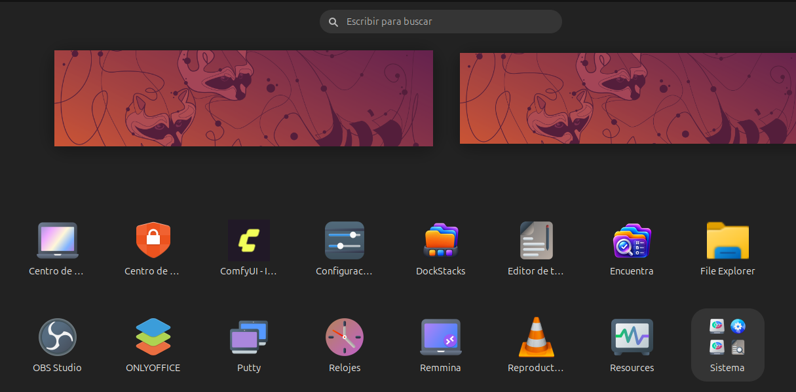

# Encuentra para Ubuntu


**Versión estable: 0.8.10-2** · Ubuntu 26.04 · GTK 4 y libadwaita

Encuentra es un buscador de archivos, carpetas y aplicaciones para Ubuntu. Utiliza un índice SQLite local y permite incluir carpetas del equipo y ubicaciones de red SMB/GVfs.

## Capturas

| Búsqueda de archivos y carpetas | Búsqueda de documentos |
| --- | --- |
|  |  |



## Instalación

Descarga `dist/encuentra_0.8.10-2_all.deb` y ejecuta:

```bash
sudo apt install ./encuentra_0.8.10-2_all.deb
```

## Uso

- Abre Encuentra desde el menú de aplicaciones o mediante el atajo configurado.
- Escribe para buscar archivos, carpetas y aplicaciones.
- Abre Configuración para añadir o quitar carpetas y unidades indexadas.
- Utiliza **Actualizar índice** para revisar los elementos de las ubicaciones configuradas.
- En Atajos de teclado, haz clic en el campo, pulsa una combinación y selecciona **Guardar**.

## Índice y configuración

Los datos del usuario se conservan en `~/.local/share/busca-ai/`. La base de datos es `files.db` y la configuración se guarda en `config.json`. No borres esos archivos para actualizar la aplicación.

## Estado de la versión

Se verificó en Ubuntu que una unidad montada en `/mnt/secundario-vm` tenía 3,222 elementos en disco y los mismos 3,222 elementos registrados en SQLite, sin faltantes ni registros obsoletos. La interfaz GTK 4, las búsquedas y el icono transparente se comprobaron visualmente. La detección de conflictos con atajos globales de GNOME no está garantizada para todas las extensiones.

## Compilación del paquete

El directorio `packaging/` contiene la estructura extraída del paquete Debian de esta versión. Para reconstruirlo:

```bash
mkdir -p dist
dpkg-deb --build --root-owner-group packaging dist/encuentra_0.8.10-2_all.deb
```

Consulta `docs/GUIA.md` para más detalles.
