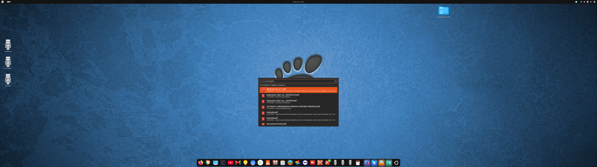

# Encuentra para Ubuntu

Buscador de archivos y carpetas para Ubuntu con una barra flotante, consultas en español y soporte para carpetas locales, NAS SMB y montajes rclone.



## Descargar e instalar

**Versión actual: 0.5.13-1.** Este repositorio incluye únicamente el instalador más reciente.

[Descargar encuentra_0.5.13-1_all.deb](dist/encuentra_0.5.13-1_all.deb?raw=true)

Desde la carpeta de descarga:

```bash
sudo apt install ./encuentra_0.5.13-1_all.deb
```

Abre **Encuentra** desde el menú de aplicaciones. El nombre interno del paquete y del comando sigue siendo `busca-ai`.

## Funciones

- Búsqueda por nombre sobre un índice SQLite local.
- Consultas en español con el prefijo `ai`, por tipo de archivo y fecha de modificación.
- Barra flotante con atajo configurable; opción para asignar **Super + Mayús + F**.
- Carpetas primero y resultados ordenados por nombre de A a Z.
- Ruta completa al pasar el mouse sobre un resultado.
- Apertura con la aplicación predeterminada y botón para abrir la carpeta contenedora.
- Carpetas locales, recursos SMB de Nautilus y montajes rclone.
- Indexado periódico con progreso, conteo de archivos y detección de montajes no disponibles.
- Exclusión manual de carpetas y filtro opcional de archivos del sistema y aplicaciones.
- Ollama opcional para interpretar las consultas; reglas en español si no está disponible.

## Primer uso

1. Abre **Configuración** y agrega las carpetas que deseas buscar.
2. Para un NAS, abre la carpeta compartida en Nautilus y pega su dirección completa `smb://servidor/recurso/` en **Agregar dirección**.
3. Para Google Drive o OneDrive, monta primero la cuenta con rclone y agrega la carpeta del montaje activo.
4. Pulsa **Guardar y actualizar índice**. Puedes cerrar la ventana mientras continúa el proceso.
5. Busca por nombre, o escribe una consulta con `ai` y pulsa Enter.

```text
factura
ai PDF de ayer
ai Excel del mes pasado
ai contrato Word
```

El modo por nombre busca el texto escrito; el modo `ai` interpreta palabras, tipos de archivo y fechas.

## Google Drive y OneDrive

Encuentra no utiliza las API directas de Google ni Microsoft. La conexión y autorización de las cuentas montadas corresponde a rclone. Agrega una ruta local como `/home/usuario/GoogleDrive`.

En la prueba del usuario, un documento abrió en unos 5 segundos mediante rclone frente a unos 40 mediante la conexión de Google de GNOME. Es un resultado de ese equipo, no una garantía de rendimiento.

## Requisitos y límites

- Python 3, PyGObject y GTK 3, instalados como dependencias del paquete.
- SQLite con FTS5 y tokenizador trigram (incluido en versiones actuales de Ubuntu).
- Nautilus/GVfs para recursos SMB; rclone y un montaje activo para nubes.
- Probado por el usuario en Ubuntu 26.04.1 con GNOME 50.1. Otras versiones no están verificadas.
- Busca nombres y metadatos; **no lee el contenido de los documentos**.
- Muestra hasta 100 resultados por consulta; precisa la búsqueda para reducir coincidencias.
- La primera revisión de una nube puede tardar según el número de carpetas, red y caché.
- Se omiten archivos ocultos y enlaces simbólicos. Los montajes rclone anidados requieren agregarse explícitamente.

## Documentación

- [Manual de uso y solución de problemas](docs/MANUAL.md)
- [Cambios de la versión actual](CHANGELOG.md)
- [Validación y capturas](docs/PRUEBAS.md)
- [Documentación incluida en el paquete](packaging/usr/share/doc/busca-ai/README.es)

## Construir el instalador

```bash
./build-deb.sh
```

El código Python está en `packaging/usr/lib/busca-ai/`. El script construye el paquete a partir del árbol `packaging`, sin incluir datos personales, índices ni credenciales.

## Desinstalar

```bash
sudo apt remove busca-ai
```

La configuración y el índice permanecen en `~/.local/share/busca-ai` (o en `XDG_DATA_HOME`). Quita también el atajo desde Configuración de GNOME si lo habías creado.
