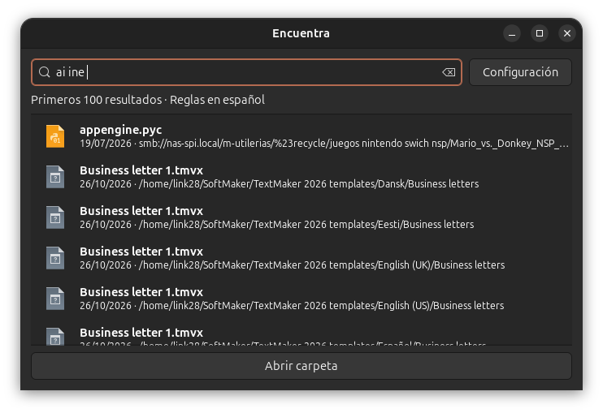
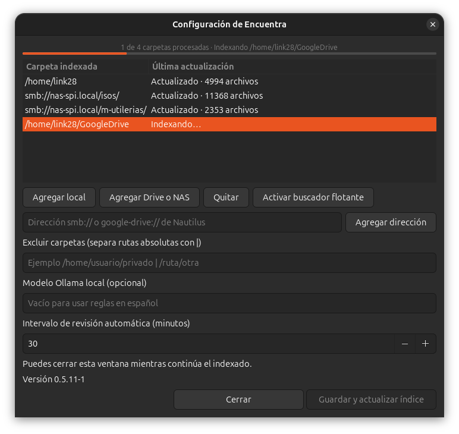
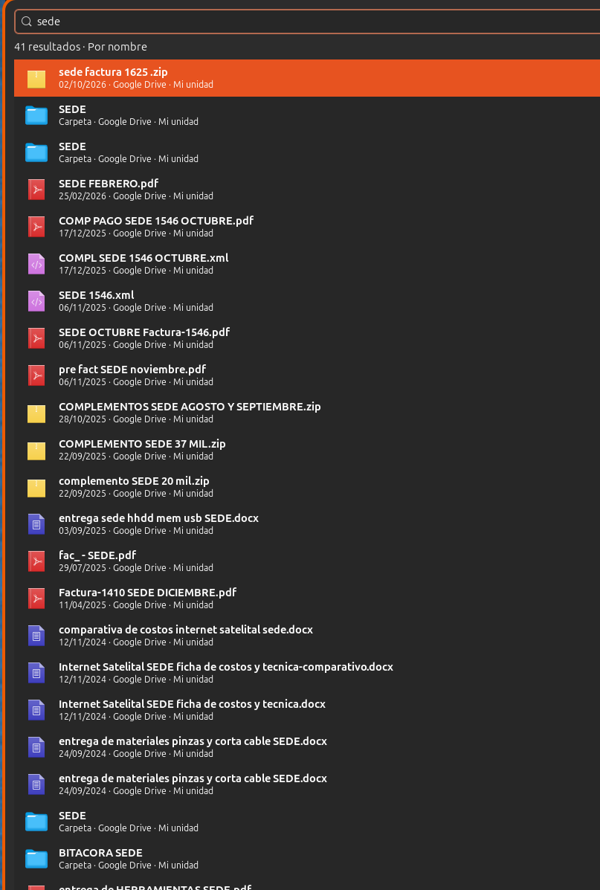

# Validación y capturas

El usuario probó Encuentra en Ubuntu 26.04.1 con GNOME 50.1. Reportó funcionamiento de apertura en Nautilus, rutas emergentes y orden de resultados. Estas son pruebas manuales del equipo del usuario.

## Búsqueda flotante

## Configuración e indexación

## Resultados y ruta emergente

Las capturas corresponden al desarrollo; su aspecto puede variar respecto de la última revisión.
